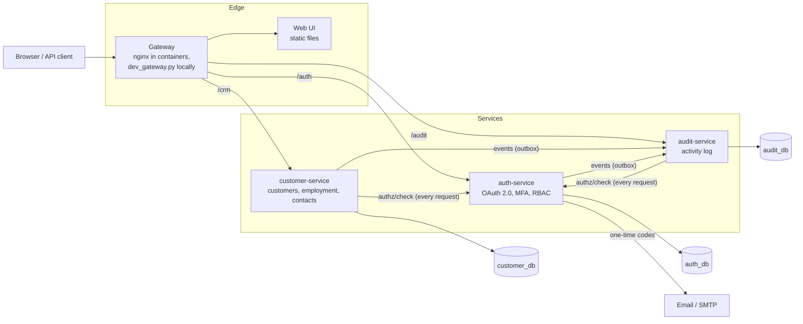
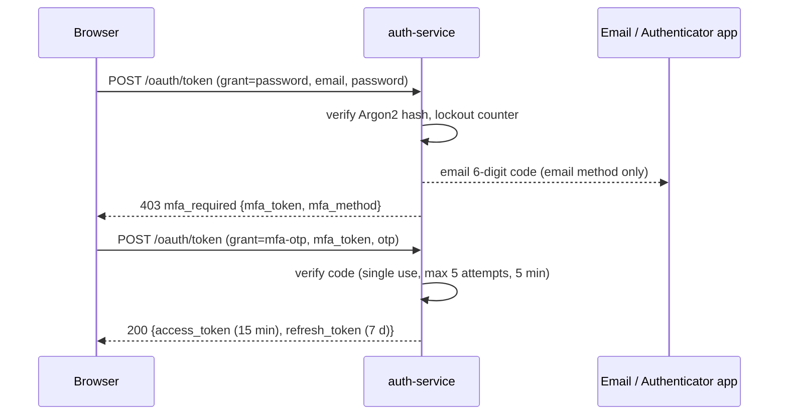
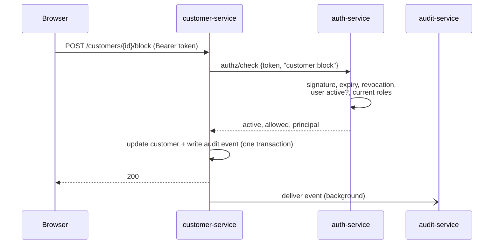
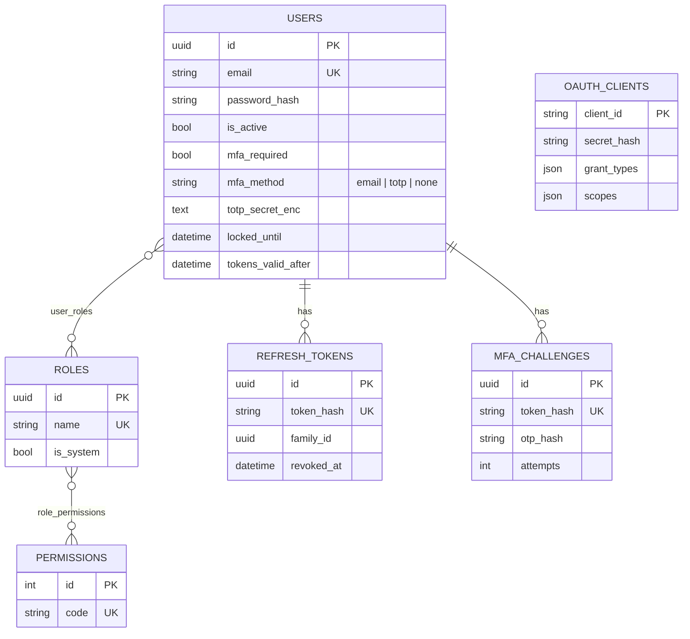
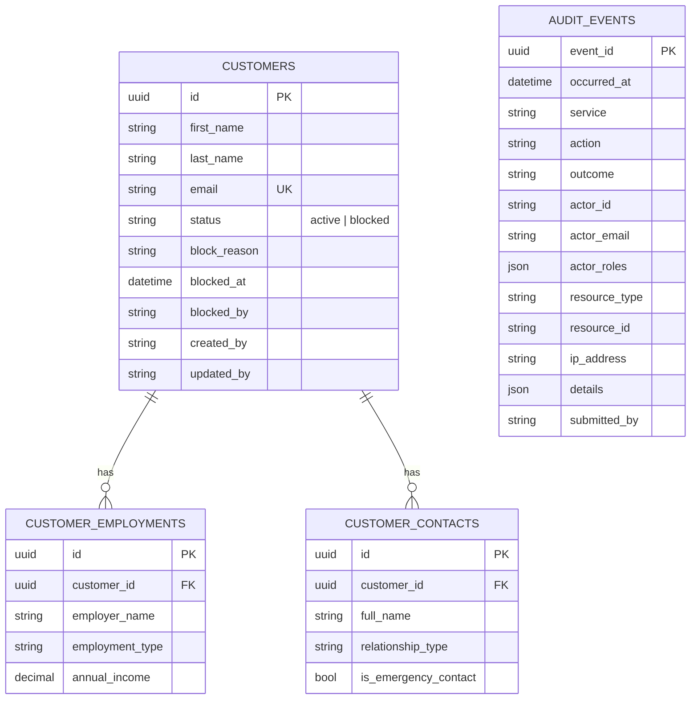

# System architecture

## 1. Overview



Each service owns its database; no service reads another's tables. The only shared code is
`shared/crm_common` (authorization client, audit outbox, logging), which is copied into each image
at build time so services still build and deploy independently.

| Component | Stack |
|---|---|
| Services | Python 3.13, FastAPI, SQLAlchemy 2 |
| Storage | PostgreSQL in containers (one database and login per service); SQLite for local runs and tests |
| Tokens | RS256 JWT access tokens (PyJWT), opaque refresh tokens |
| Passwords / MFA | Argon2id; TOTP (RFC 6238) and emailed one-time codes |
| Gateway | nginx; a small Starlette proxy stands in for it locally |
| UI | Plain HTML/CSS/JS, no build step |

## 2. Authentication (OAuth 2.0 + MFA)

The auth service is an OAuth 2.0 authorization server. Supported grants:

| Grant | Used by | Notes |
|---|---|---|
| `password` | Web UI (public client `crm-web`) | Step 1 of sign-in. Answers `403 mfa_required` with an `mfa_token`. Returns tokens directly in two cases: a role grants the account `auth:mfa:skip`, or an administrator has exempted the account from MFA and it has no second factor. |
| `urn:crm:params:oauth:grant-type:mfa-otp` | Web UI | Step 2: `mfa_token` + one-time code returns the tokens. |
| `refresh_token` | Web UI | Rotated on every use, with reuse detection. |
| `client_credentials` | Services | Confidential clients, HTTP Basic. |



Whether the password step asks for a code:

| Account | Result |
|---|---|
| Default | Code required: emailed, or from an authenticator app once the user enrols one |
| A role grants `auth:mfa:skip` | No code, whatever second factor is set up. `admin` always holds it |
| Administrator set `mfa_required=false` and the user has no second factor | No code |

- A user can switch between email and authenticator app; switching back needs the password. An
  administrator can reset a lost device.
- An account made optional keeps its second factor until the user turns it off. Made required
  again, it goes back to emailed codes at once. Administrators cannot change their own setting.
- Removing the role or permission brings the code step back; the account's own setting is untouched.
- Every sign-in is logged with the factor used (`mfa_method`, and `mfa_skipped_by` when a
  permission skipped the code), so password-only accounts are easy to find.
- Administrators signing in without a code is a convenience chosen for this system. A leaked
  administrator password is then enough to sign in; lockout still applies.

Protections in the login path:

- Unknown user and wrong password are indistinguishable (same message, same hashing cost).
- Five consecutive failures lock the account for 15 minutes; an administrator can unlock it.
- Email codes are stored only as a hash bound to their challenge. TOTP secrets are encrypted at rest.
- A TOTP code cannot be replayed: the last accepted time-step is stored.
- Refresh tokens are stored hashed. Presenting an already-rotated refresh token ends that whole session.
- Password change, deactivation and MFA reset end all of the user's sessions at once.
- The gateway rate-limits the token endpoint per IP (container deployment).

Standards endpoints: token (RFC 6749), revocation (RFC 7009), introspection (RFC 7662), server
metadata (RFC 8414), JWKS.

## 3. Authorization (central RBAC)

Model: **user → roles → permissions**. A permission is a string such as `customer:block`. The catalogue
is fixed in code; roles are data and can be created and edited by administrators.

Resource services contain no token validation and no role logic. For each request they call:

```
POST auth-service /api/v1/authz/check      (HTTP Basic: the service's own client id + secret)
{ "token": "<caller's access token>", "permission": "customer:block" }
→ { "active": true, "allowed": false, "principal": { id, type, email, name, roles, permissions } }
```



The auth service reads account state and roles from its database on every check, so the token's own
claims are never trusted for permissions. Consequences:

- Deactivating a user, changing their roles, or editing a role takes effect on the next request, not
  when the token expires. (Covered by tests and the smoke test.)
- If the auth service is unreachable, services answer 503. They fail closed.
- The cost is one internal HTTP call per request. That is the deliberate trade for a basic CRM; if it
  ever matters, the published JWKS allows local signature checks with a short decision cache.

Service scopes (`authz:check`, `audit:write`) exist only on service clients and cannot be granted to
a role, so no user can write to the activity log or call the decision endpoint.

Three points beyond the basic model:

- `authz/check` can be called without a permission; it then only authenticates the token. The audit
  service uses this, because every signed-in user may read the log and the question is how much.
- `user:read` (the list of users) and `audit:read` (everyone's activity) are in `admin` only by
  default. An administrator can put either in another role on purpose.
- `auth:mfa:skip` changes how its holder signs in (section 2) and grants access to nothing.

Note: `user:manage` and `role:manage` are administrative powers by nature. Someone holding them can
grant themselves any other permission. They are in the `admin` role only.

## 4. Customer management

| Action | Permission |
|---|---|
| View / search customers, employment, contacts | `customer:read` |
| Add a customer | `customer:create` |
| Edit a customer | `customer:update` |
| Block / unblock | `customer:block` |
| Add, edit, remove employment records | `customer:employment:manage` |
| Add, edit, remove related contacts | `customer:contact:manage` |
| Delete a customer permanently | `customer:delete` (in the `admin` role only by default) |

Rules: email is unique (case-insensitive). Blocking requires a reason and records who and when. A
blocked customer is read-only (the record and its employment/contacts) until unblocked; attempts
return 409, including an attempt to delete it. Deleting removes the customer with its employment
records and contacts; the activity log keeps a copy of the deleted record.

Input rules are defined once in `shared/crm_common/validation.py` and enforced by the services: names
and place names are letters of any script (no digits or symbols), phone numbers have 7 to 15 digits,
dates of birth are between 1900 and today, and a current job cannot have an end date. The web UI
repeats the same rules on its inputs only so the browser can point at the field before sending.

Users can be deleted by anyone holding `user:manage`, except their own account and the last active
administrator. The bootstrap administrator from `.env` is created only while no administrator exists,
so a deleted or renamed one does not come back at the next start.

## 5. Activity logging

Every action produces an event with: time (UTC), service, action, outcome, actor (id, type, email,
name, roles at that moment), record type and id, IP address, user agent, request id, and details
(for edits, each changed field with its old and new value).

What is logged:

| Area | Events |
|---|---|
| Sign-in | challenge issued, MFA failed, login succeeded/failed (with reason), account locked, logout, refresh-token reuse |
| Account | password changed/reset, MFA method changed/reset, unlocked |
| Administration | user created/updated/deleted, role created/updated/deleted |
| Authorization | every denied permission check, with the permission and calling service |
| Customers | searched, viewed, created, updated, blocked, unblocked, deleted; employment and contact viewed/added/updated/removed |
| Activity log | viewing and exporting the log are themselves logged, with the filters used |

Not logged as audit events: reads of the user and role lists in the auth service. Those requests still
appear in the structured access log (below), without the user identity.

Delivery uses a **transactional outbox**. The service writes the event to an `audit_outbox` table in
the same database transaction as the change itself, so a change and its audit record cannot exist
without each other. A background worker delivers batches to the audit service and marks them sent.
Delivery is at-least-once; the audit service ignores an `event_id` it already has. If the audit
service is down, events wait in the outbox (typical delay when healthy: up to 2 seconds).

The audit service exposes no update or delete operations, and records which authenticated service
delivered each event.

Who can read the log:

| Caller | Sees |
|---|---|
| Holds `audit:read` (the `admin` role only, by default) | Every event |
| Any other signed-in user | Their own account only: events they caused, and events on their own user record (sign-in attempts, a password reset or role change by an administrator) |

The rule is applied in the database query of the audit service, after the auth service has
authenticated the token, so it covers search, single events and the CSV export alike, and no filter
can widen it. An event outside the caller's view answers 404. The export is newest first, capped at
50,000 rows per download; values that a spreadsheet would treat as formulas are neutralised.

Separately, every service writes one JSON log line per request to stdout (method, path, status,
duration, IP, request id). The gateway assigns the request id and it is carried into audit events,
so a log entry can be traced across services.

## 6. Data model





`audit_events` lives in the audit service's own database. Auth and customer services each also have
an `audit_outbox` table (payload, created_at, sent_at).

## 7. Known limits

These are deliberate scope cuts for a basic system, listed so nobody discovers them later:

- **Administrators sign in without a second factor** (`auth:mfa:skip`, section 2). Chosen for
  convenience; remove the permission from the catalogue or stop forcing it into `admin` before real use.
- **Password grant, not authorization-code + PKCE.** The UI collects the password and posts it to the
  token endpoint. This is acceptable for a first-party UI on the same origin, and it is what makes the
  two-step MFA flow simple, but OAuth 2.1 drops this grant. A third-party client would need the
  authorization-code flow with a login page hosted by the auth service.
- **Tokens in `sessionStorage`.** The UI keeps tokens in the browser tab. A strict Content-Security-Policy
  (no inline or third-party script) limits the exposure, but an HttpOnly-cookie session at the gateway
  would be stronger.
- **Default roles are seeded once.** Changing a default role in code (as when `user:read` and
  `audit:read` were taken out of `manager`) does not change that role in a database that already
  exists; edit the role there through the API or UI.
- **No schema migrations.** Tables are created at startup. This already cost something once: adding
  `users.mfa_required` needed a manual `ALTER TABLE` on the existing local database. Add Alembic.
- **No clean-up job** for expired challenges, refresh tokens, revoked-token ids or sent outbox rows.
- **Signing key is a single file** on a volume. There is no key rotation.
- **Audit log has no tamper-evidence** (hash chain or WORM storage) beyond having no write API for users.
- **Container stack not yet run.** See `docs/DEPLOYMENT.md`.
